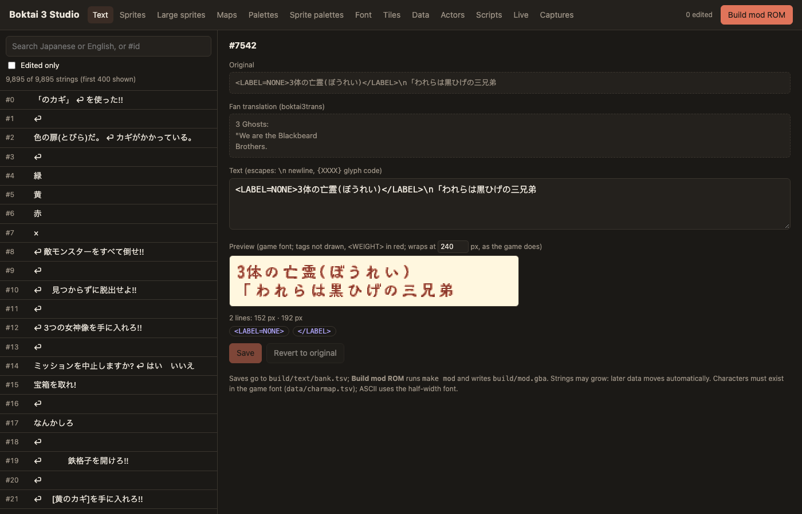
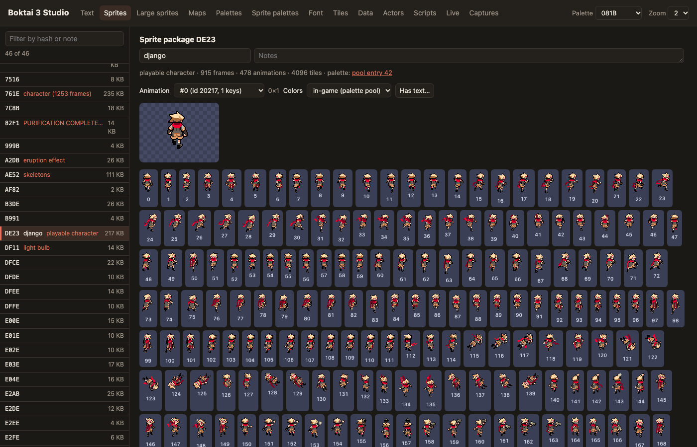
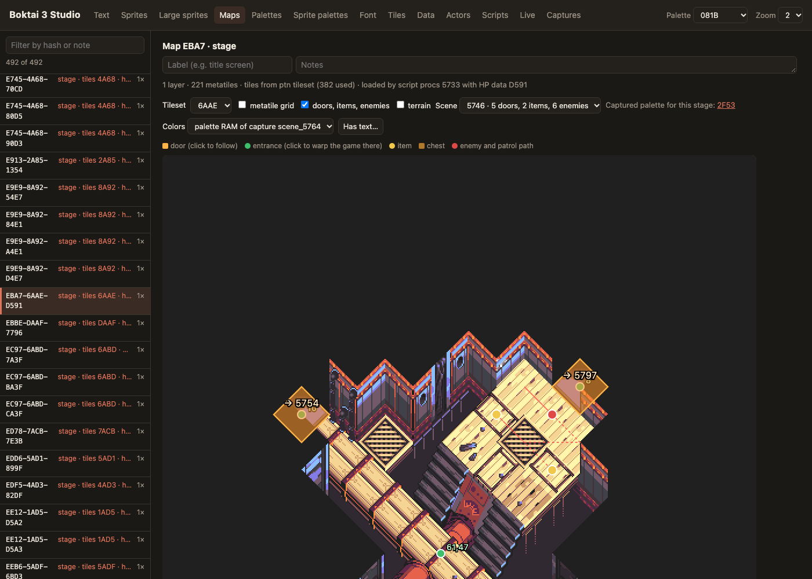
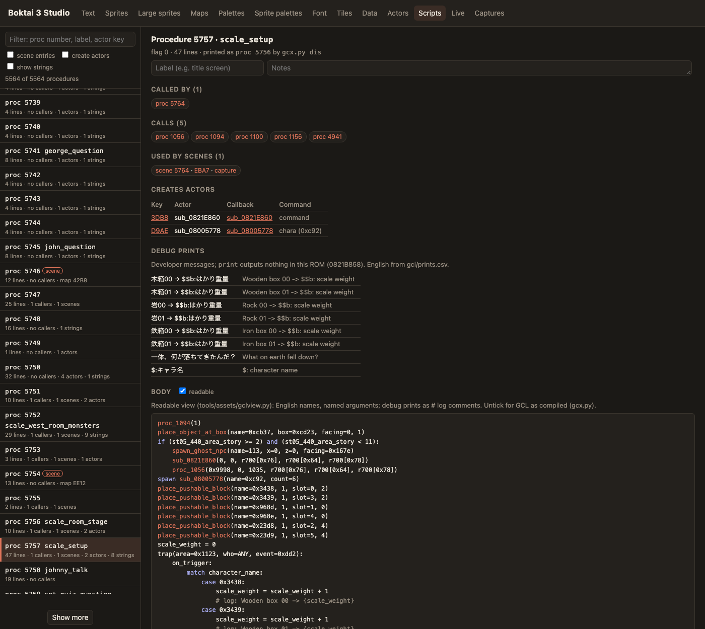
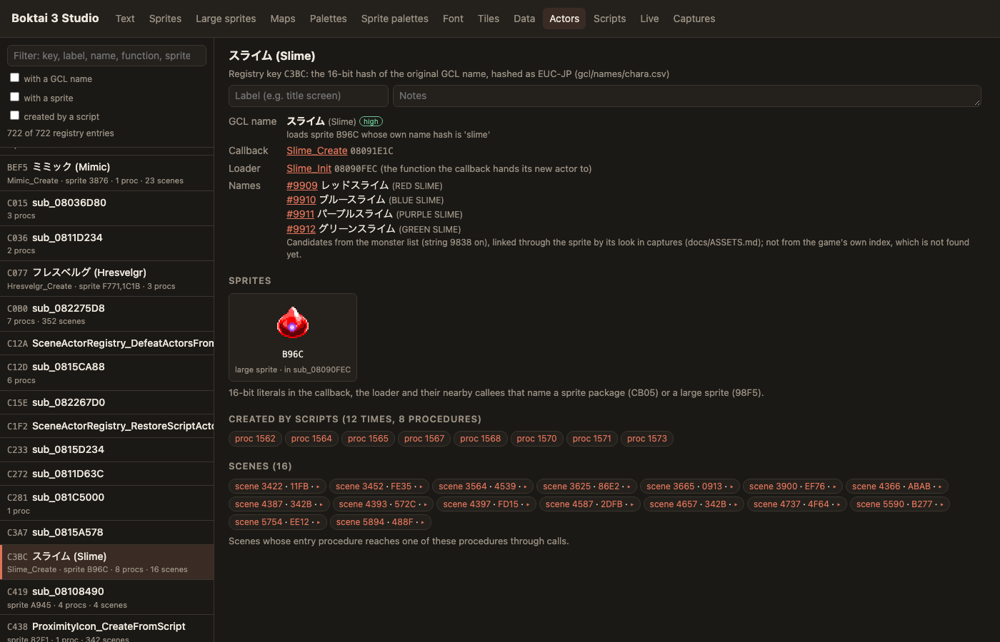
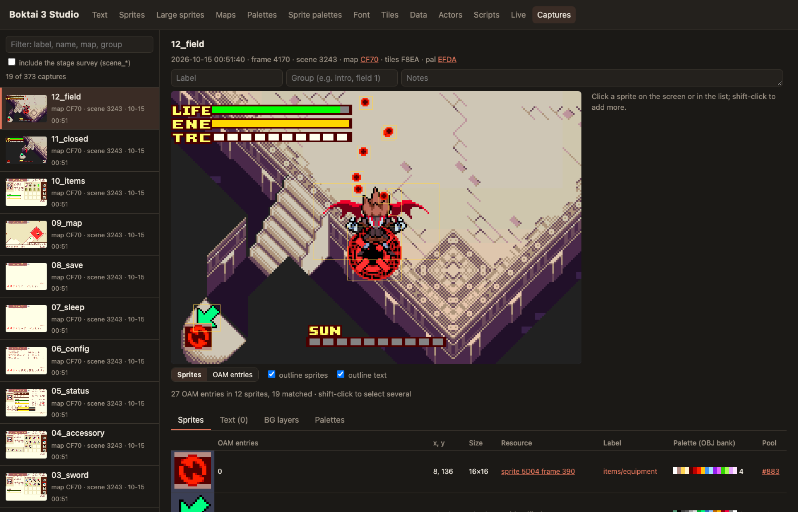

# Boktai 3 decomp

[](https://decomp.dev/moozilla/boktai3-decomp)
[](https://decomp.dev/moozilla/boktai3-decomp)

A matching decompilation of **Shin Bokura no Taiyou: Gyakushuu no Sabata**
(Boktai 3, GBA, `U33J`): C source that compiles back to the original ROM byte
for byte, plus a local studio for reading and editing the game's text,
graphics, maps and scripts.

## About

This project started as a way to revive the English fan translation I worked
on back in 2007 ([boktai3trans](https://github.com/moozilla/boktai3trans)). It
has since grown into editing tools and a studio for digging into how the game
actually works. Boktai 3 turned out to be a deeper rabbit hole than I expected:
its scenes run on GCL, the scripting system Konami also used in Metal Gear
Solid, so the game's logic can be read back almost like source. Eventually I'd
like the tools to cover the whole Boktai series.

This project is entirely agent-driven: all code and documentation is written by
AI agents (Claude Opus 5.5, GPT-6 Astra and GPT-6.1 Sol, with teams of Sonnet,
Haiku and Luna subagents) that I direct and review. I was inspired by Chris
Lewis's posts on [decompiling Snowboard Kids with coding agents](https://blog.chrislewis.au/using-coding-agents-to-decompile-nintendo-64-games/),
and one of my goals is to see how deep fully agentic decompilation and ROM
hacking can go. I aim to stand apart from the AI-generated ports that led to
[decomp.dev's sunsetting](https://decomp.dev): this comes from a deep curiosity
about the game. ROM hacking was my main hobby as a teenager, much of it on fan
translations. I now work as a professional software developer, with almost a
decade of writing production code by hand. I don't believe agents *have to be*
a force for disempowerment: with creativity, agents can allow you to go deeper
and be far more ambitious than you ever could before. I'm hoping to prove that
with this project.

## State of the decomp

| | |
|---|---|
| Matching | [PROGRESS.md](PROGRESS.md) and the badges above; the ROM rebuilds byte-identical |
| Data | every ROM pointer is a symbol, so all data can move or grow ([shiftability](docs/SHIFTABILITY.md)) |
| Scripts | the scene scripts are compiled GCL, Konami's scripting language (documented by the Metal Gear Solid reverse-engineering community: [KCEJ wiki](https://github.com/metalgeardev/KCEJ_Wiki/tree/master/common/gcl), [mgs_reversing](https://github.com/FoxdieTeam/mgs_reversing/tree/master/source/libgcl)); bytecode, interpreter and recovered names in [gcl/](gcl/README.md) |
| Assets | text bank, font, sprites, maps, palettes, terrain and stage scripts decoded ([docs/ASSETS.md](docs/ASSETS.md)) |

## Toolchain

| | |
|---|---|
| Compiler | [agbcc](https://github.com/pret/agbcc) (pret's GCC 2.95 for the GBA), `-O2 -mthumb-interwork`; `old_agbcc` and ARM mode for some libraries |
| Libraries | MP2K sound (`m4a`), libgcc and fdlibm, RTC, EEPROM and the RFU wireless SDK, matched in C |

Current work and next steps: [docs/HANDOFF.md](docs/HANDOFF.md). All docs: [docs/INDEX.md](docs/INDEX.md).

## Setup

Supply your own ROM at `baserom.gba` (SHA-1 `2651c5e6875ac60abff734510d152166d211c87c`).
Nothing derived from it is committed.

macOS (Homebrew, Xcode Command Line Tools):

```sh
brew install cmake arm-none-eabi-binutils mgba python
python3 -m venv build/venv && source build/venv/bin/activate
python -m pip install -r requirements.txt
make setup     # pinned gbadisasm, agbcc, armips, permuter, mGBA harness
```

Debian/Ubuntu: `apt install build-essential cmake binutils-arm-none-eabi libmgba-dev python3-numpy python3-pil`, then the same `pip` and `make setup`.

## Building

```sh
make disasm      # generate the disassembly into gen/ (~18 min, once)
make             # compile, link, verify: prints build/boktai3.gba: OK
make shifttest   # move all data by 64 KiB and compare emulator screenshots
make mod         # build/mod.gba from edited text and assets
```

To match a function: `python3 tools/scope/scope.py rom FUNC` to read it, write C
under `src/`, `python3 tools/scope/scope.py FILE.c FUNC` to compare it with the ROM
and see why it differs, then `make`. The workflow and compiler notes are in
[docs/WORKER.md](docs/WORKER.md) and [tools/scope/](tools/scope/README.md).

## Studio

```sh
python3 tools/studio/serve.py    # http://localhost:8642
```

**Browse** (`/atlas`) is the way in: everything in the game as one tree
(the story, beat by beat; characters, the monster list in the game's order,
objects, places in story order, cutscenes with their timelines, items, scripts, script commands, sprites,
songs and code by subsystem), each
with one page of everything known about it: a monster family's species and
every palette its sprites are drawn in, where it appears, the scripts that
create it and how much of its code is decompiled. ⌘K searches everything;
links to the views below open in a side panel with its own history. The index
is built by `tools/studio/atlas.py`. Groups come from the game and the code, not
from hand-made categories: the Cast is the game's character list plus every
speaker of dialogue in the scripts (with their lines and scenes), the Bestiary
the game's monster list, Objects and Script routines the registry entries by
the code subsystem their callback is in. An object's page lists its own
sprites and palettes, the sprite packages, maps, tilesets and animations its
code looks up (`sub_0821A520(type, hash)`), and the scenes whose own scripts
place it; a scene opened from there marks it on the map. **ROM** (`/rom`) is
the ROM as a treemap in address order, colored by kind or by how well each
byte is understood.

| | |
|---|---|
|  | **Text**: every string with the fan translation, previewed in the game font at the game's line width; *Build mod ROM* writes a playable ROM. |
|  | **Sprites**: sprite packages and large sprites with every frame and animation, in their in-game palettes. |
|  | **Maps**: stages with captured palettes, doors, entrances, items, enemies and patrol paths from the stage scripts. |
|  | **Scripts**: procedures in a readable view with recovered names, the developers' debug messages and their translations. |
|  | **Actors**: every object a script can create, with its GCL name, code, sprites and scenes. |
|  | **Screen inspector** (Live and Captures): every sprite, text box, layer and palette on screen, matched to its resource. Live mode connects to mGBA through [Centaur](docs/CENTAUR.md). |

Also: palette, font and tile viewers, and **Sound** (`/sound`): every song in
the song table with its tracks, voices and the scripts, scenes and code that
start it, played in the browser by a small MP2K player (`tools/studio/mp2k.js`)
from the ROM's own sequence and sample data.

## Layout

Decompilation:

| Path | Contents |
|---|---|
| `src/`, `include/`, `asm/` | decompiled C, headers, hand-written asm |
| `symbols/` | function and data names, pointer evidence |
| `data/` | data tables kept as source (actor registry, charmap, items) |
| `tools/*.py` | build, split, check, worklist, permuter, progress |
| `gen/`, `build/` | generated from the ROM, never committed |

Studio and tooling:

| Path | Contents |
|---|---|
| `tools/studio/` | the Studio |
| `tools/assets/` | asset and script decoders (`gcx.py`, `gclview.py`, `stages.py`, `sprites.py`, `text.py`) |
| `tools/mgba/`, `tools/emu/` | Centaur (desktop mGBA script), headless emulator harness |
| `gcl/` | recovered script names, debug-print translations, worked examples |

Documentation:

| Path | Contents |
|---|---|
| `docs/` | engine, subsystems and process; start at [docs/INDEX.md](docs/INDEX.md) |
| `notes/` | per-batch worker notes |

## License

MIT ([LICENSE](LICENSE)). Third-party code and its licenses: [THIRD_PARTY.md](THIRD_PARTY.md).
Boktai 3 is © Konami; the ROM is not included.
