# Boktai 3 decomp

[](https://decomp.dev/moozilla/boktai3-decomp)
[](https://decomp.dev/moozilla/boktai3-decomp)

A matching decompilation of **Shin Bokura no Taiyou: Gyakushuu no Sabata**
(Boktai 3, GBA, `U33J`): C source that compiles back to the original ROM byte
for byte, plus a local studio for reading and editing the game's text,
graphics, maps and scripts.

## About

This project started as a way to revive the English fan translation I worked
on back in 2007 ([boktai3trans](https://github.com/moozilla/boktai3trans)). It
has since grown into editing tools and a studio for digging into how the game
actually works. Boktai 3 turned out to be a deeper rabbit hole than I expected:
its scenes run on GCL, the scripting system Konami also used in Metal Gear
Solid, so the game's logic can be read back almost like source. Eventually I'd
like the tools to cover the whole Boktai series.

This project is entirely agent-driven: all code and documentation is written by
AI agents (Claude Opus 5.5, GPT-6 Astra and GPT-6.1 Sol, with teams of Sonnet,
Haiku and Luna subagents) that I direct and review. I was inspired by Chris
Lewis's posts on [decompiling Snowboard Kids with coding agents](https://blog.chrislewis.au/using-coding-agents-to-decompile-nintendo-64-games/),
and one of my goals is to see how deep fully agentic decompilation and ROM
hacking can go. I aim to stand apart from the AI-generated ports that led to
[decomp.dev's sunsetting](https://decomp.dev): this comes from a deep curiosity
about the game. ROM hacking was my main hobby as a teenager, much of it on fan
translations. I now work as a professional software developer, with almost a
decade of writing production code by hand. I don't believe agents *have to be*
a force for disempowerment: with creativity, agents can allow you to go deeper
and be far more ambitious than you ever could before. I'm hoping to prove that
with this project.

## State of the decomp

| | |
|---|---|
| Matching | **every function matches**: all 11,810 compile from C to the original bytes, and the ROM rebuilds byte-identical ([PROGRESS.md](PROGRESS.md)) |
| Concessions | about 16% of code still matches only with register pins, `asm("")` barriers or another concession ([tools/concessions.py](tools/concessions.py)); removing them is the current work, and decomp.dev counts a function as matched only once it has none |
| Data | every ROM pointer is a symbol, so all data can move or grow ([shiftability](docs/SHIFTABILITY.md)) |
| Scripts | the scene scripts are compiled GCL, Konami's scripting language (documented by the Metal Gear Solid reverse-engineering community: [KCEJ wiki](https://github.com/metalgeardev/KCEJ_Wiki/tree/master/common/gcl), [mgs_reversing](https://github.com/FoxdieTeam/mgs_reversing/tree/master/source/libgcl)); bytecode, interpreter and recovered names in [gcl/](gcl/README.md) |
| Assets | text bank, font, sprites, maps, palettes, terrain and stage scripts decoded ([docs/ASSETS.md](docs/ASSETS.md)) |

Every function now matches, but not all of it is the C the original authors wrote. The
work left comes in two phases ([docs/ROADMAP.md](docs/ROADMAP.md)):

1. **No concessions** (current): rewrite the remaining matches as ordinary C, with no register
   pins (`register T x asm("rN")`) and no empty `asm("")` barriers. These are stopgaps that
   force a register choice or block an optimization, so the C only matches with them.
2. **Cleanup**: make the source read like the original, with real names for every function
   and RAM object, shared structs and types, files grouped by subsystem instead of one file per
   function, and code and RAM that the linker places itself.

## Toolchain

| | |
|---|---|
| Compiler | [agbcc](https://github.com/pret/agbcc) (pret's GCC 2.95 for the GBA), `-O2 -mthumb-interwork`; `old_agbcc` and ARM mode for some libraries |
| Libraries | MP2K sound (`m4a`), libgcc and fdlibm, RTC, EEPROM and the RFU wireless SDK, matched in C |

Current work and next steps: [docs/HANDOFF.md](docs/HANDOFF.md). All docs: [docs/INDEX.md](docs/INDEX.md).

## Setup

Supply your own ROM at `baserom.gba` (SHA-1 `2651c5e6875ac60abff734510d152166d211c87c`).
Nothing derived from it is committed.

macOS (Homebrew, Xcode Command Line Tools):

```sh
brew install cmake arm-none-eabi-binutils mgba python
python3 -m venv build/venv && source build/venv/bin/activate
python -m pip install -r requirements.txt
make setup     # pinned gbadisasm, agbcc, armips, permuter, mGBA harness
```

Debian/Ubuntu: `apt install build-essential cmake binutils-arm-none-eabi libmgba-dev python3-numpy python3-pil`, then the same `pip` and `make setup`.

## Building

```sh
make disasm      # generate the disassembly into gen/ (~18 min, once)
make             # compile, link, verify: prints build/boktai3.gba: OK
make shifttest   # move all data by 64 KiB and compare emulator screenshots
make mod         # build/mod.gba from edited text and assets
```

To match a function: `python3 tools/scope/scope.py rom FUNC` to read it, write C
under `src/`, `python3 tools/scope/scope.py FILE.c FUNC` to compare it with the ROM
and see why it differs, then `make`. The workflow and compiler notes are in
[docs/WORKER.md](docs/WORKER.md) and [tools/scope/](tools/scope/README.md).

## Studio

```sh
python3 tools/studio/serve.py    # http://localhost:8642 opens Browse
```

One local app over the game and the decomp. The header groups every view;
**⌘K** (or `/`) on any page searches everything at once: monsters,
characters, places, items, sprites, songs, scripts, functions, RAM objects
and lines of text, or a scene number or resource hash (`tools/studio/search.py`).
Links to other views open in a side panel with its own history. Every view
names places the same way: World's places (`tools/studio/places.py`, from
`data/labels/areas.csv`), so a scene file, capture, song or palette says
where in the game it belongs.

**Browse** (`/atlas`) is the way in: everything in the game as one tree
(the story, beat by beat; characters, the monster list in the game's order,
objects, places in story order, cutscenes with their timelines, items, scripts, script commands, sprites,
songs and code by category), each
with one page of everything known about it: a monster family's species and
every palette its sprites are drawn in, where it appears, the scripts that
create it and its code. The index
is built by `tools/studio/atlas.py`. Groups come from the game and the code, not
from hand-made categories: the Cast is the game's character list plus every
speaker of dialogue in the scripts (with their lines and scenes), the Bestiary
the game's monster list, Objects and Script routines the registry entries by
the code unit their callback is in. An object's page lists its own
sprites and palettes, the sprite packages, maps, tilesets and animations its
code looks up (`sub_0821A520(type, hash)`), and the scenes whose own scripts
place it; a scene opened from there marks it on the map.

**Code** (`/code`) shows the finished decomp: every function by category and
unit (the same tree as [PROGRESS.json](PROGRESS.json) and decomp.dev), each
with its C next to its disassembly. Lines that still hold a matching
concession are marked, as are the drafts that don't match yet and the SDK's
own hand-written assembly, and identifiers link through: calls, callers, the
callbacks that take a function's address, the RAM objects (`symbols/ram.csv`)
and ROM data it loads, and the objects and script routines in the game that
reach it. A RAM object's page lists every function that uses it; a struct
type's page shows its definition with each member's offset, as agbcc lays it
out, and the functions that use it. **Concessions left** lists every function
still holding a pin, barrier or other concession, by kind, and the overview
graphs progress over time from every committed `PROGRESS.md` and lists what
each recent merge changed: the functions that became concession-free, gained a
concession or stopped matching; a function's page says which merge made it
match and which made it concession-free. The index is
`tools/studio/codemap.py`, built from `tools/progress.py` and
`tools/concessions.py`. **ROM** (`/rom`) is the ROM as a treemap in address
order, colored by kind or by how well each byte is understood.

| | |
|---|---|
| 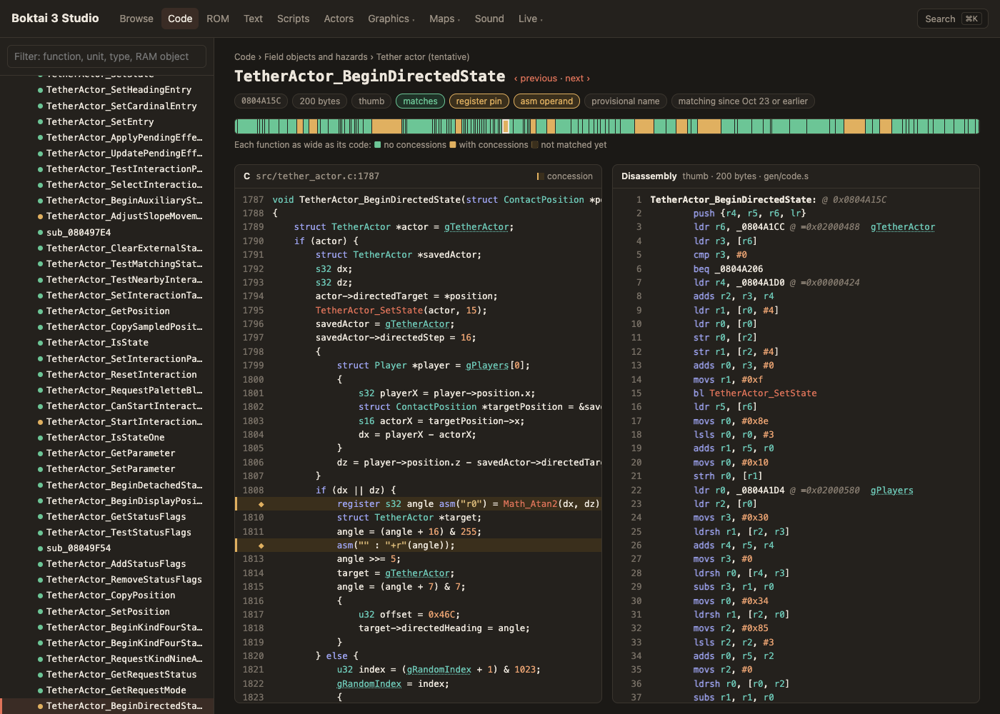 | **Code**: a function's C and disassembly side by side, with its concessions, the RAM it touches and where the game reaches it. |
| 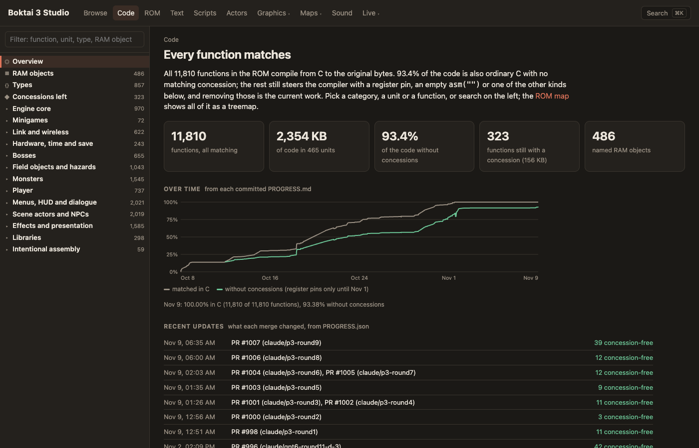 | **Code overview**: what matches, what is free of concessions, by category, which concession kinds are left, and progress over time. |
| 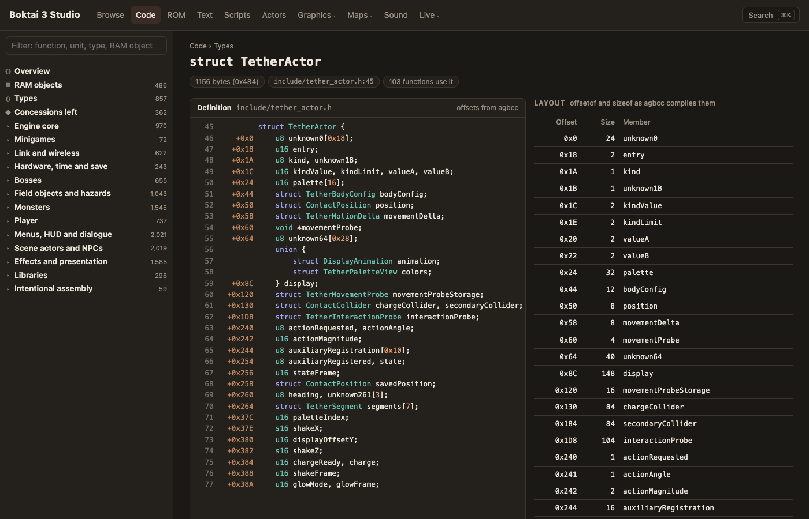 | **Types**: a struct's definition with each member's offset as agbcc lays it out, and the functions that use it. |
| 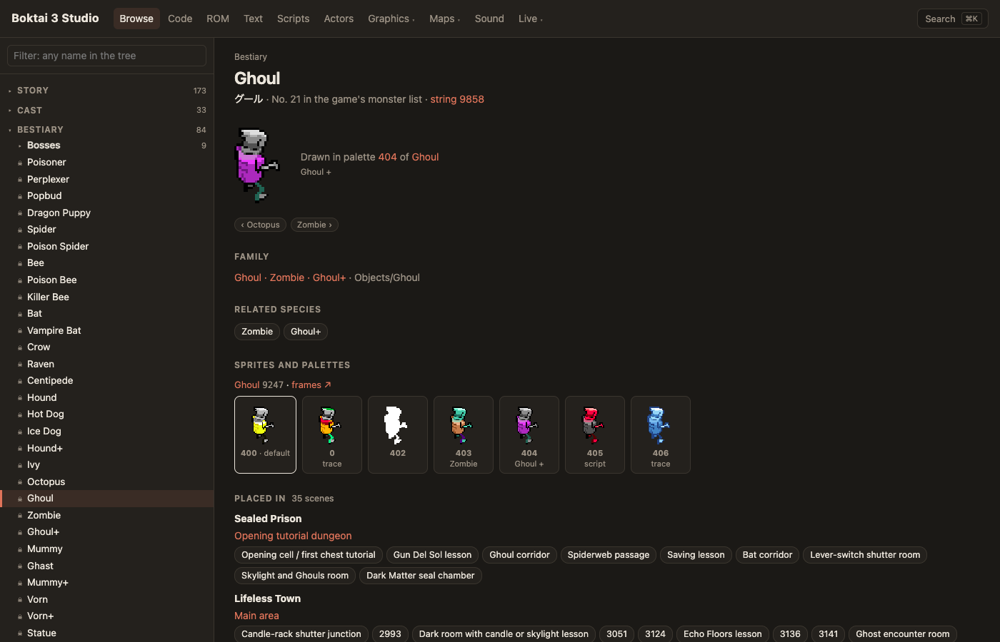 | **Browse**: a monster with its family, every palette its sprites are drawn in, and the scenes that place it. |
| 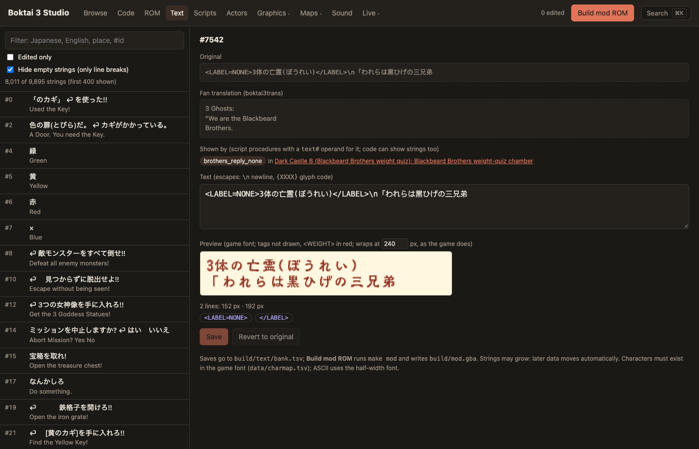 | **Text** (`/text`): every string with the fan translation and the scripts that show it (and where they run), previewed in the game font at the game's line width; *Build mod ROM* writes a playable ROM. |
| 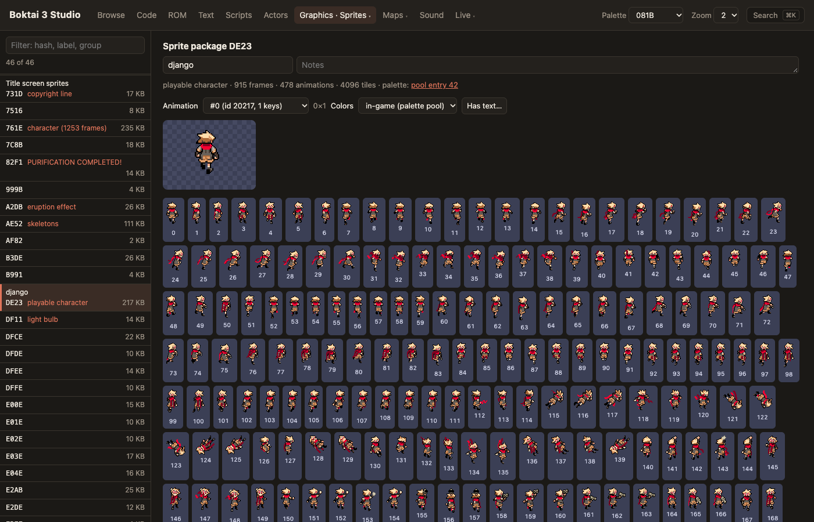 | **Sprites**: sprite packages and large sprites with every frame and animation, in their in-game palettes. |
| 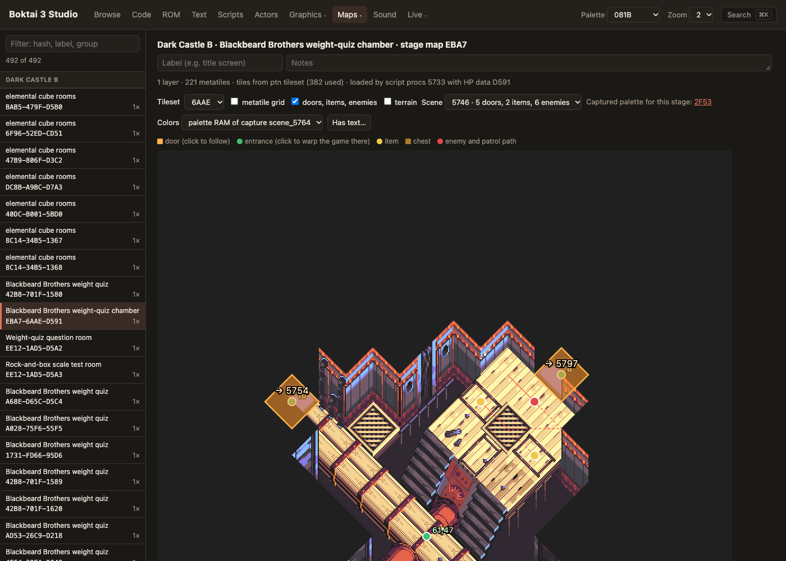 | **Maps**: stages grouped by place in story order, with captured palettes, doors, entrances, items, enemies and patrol paths from the stage scripts. |
| 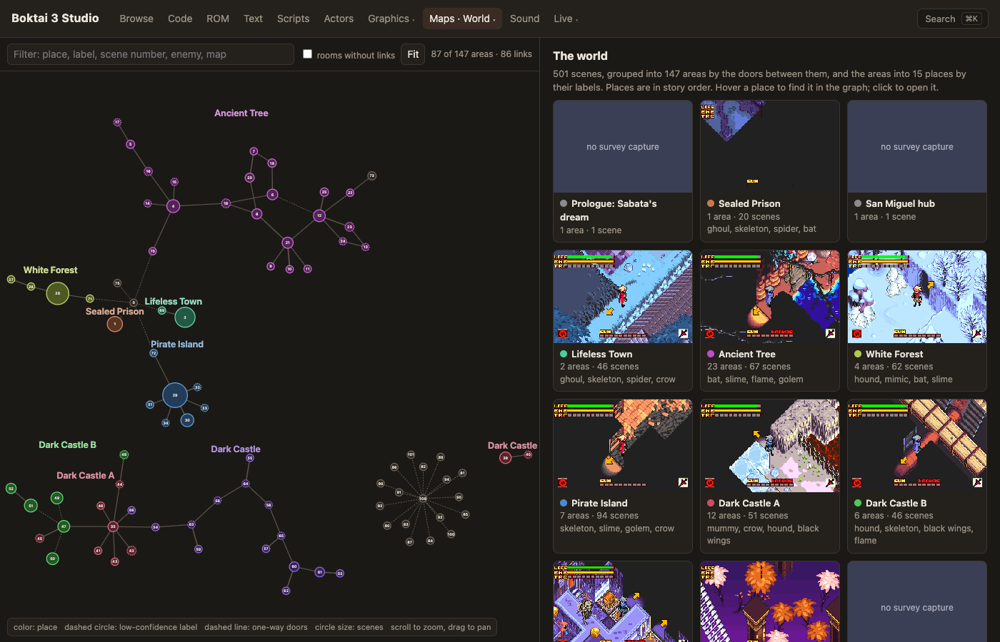 | **World** (`/world`): how the rooms connect. Scenes grouped into areas by their doors, areas into places by their labels, each place with its rooms, captures and enemies. |
| 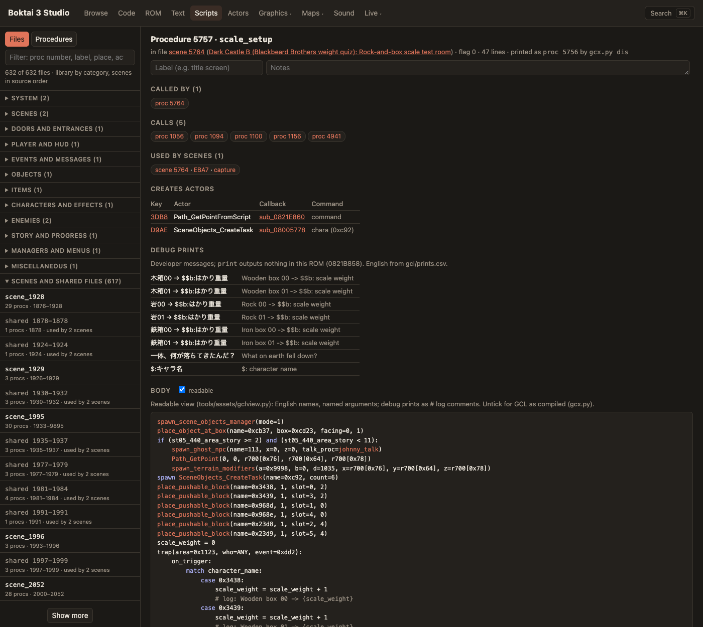 | **Scripts**: script files and procedures in a readable view with recovered names, each scene file's place, the developers' debug messages and their translations. |
| 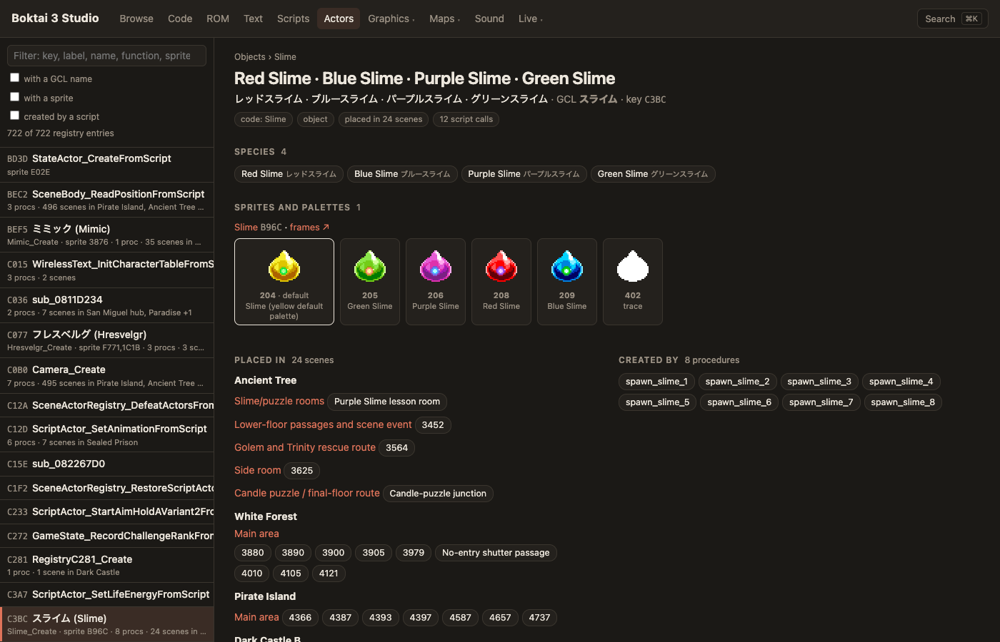 | **Actors**: the script registry, every object a script can create, filterable by GCL name, sprite or use, each shown with its Browse page; plus the decoded command and parameter tables. |
| 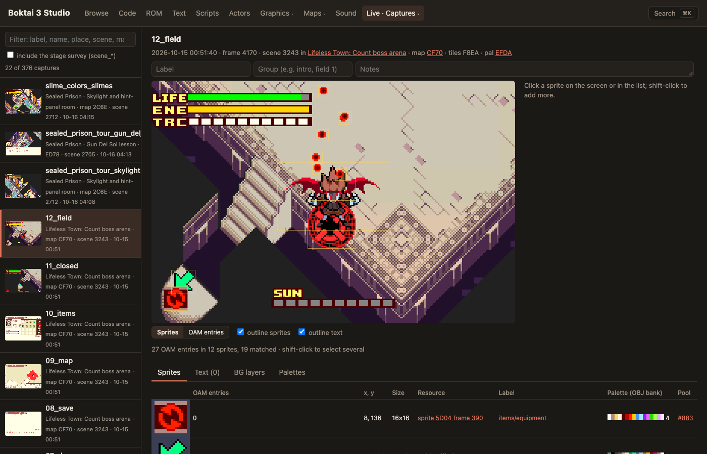 | **Screen inspector** (Live and Captures): every sprite, text box, layer and palette on screen, matched to its resource. Live mode connects to mGBA through [Centaur](docs/CENTAUR.md). |

Also: palette (with the places that load each), font and tile viewers, dungeons stitched from their rooms, and **Sound** (`/sound`): every song in
the song table with its tracks, voices and the scripts, scenes and code that
start it, played in the browser by a small MP2K player (`tools/studio/mp2k.js`)
from the ROM's own sequence and sample data. `python3 tools/studio/shots.py`
retakes these screenshots from a running Studio.

## Layout

Decompilation:

| Path | Contents |
|---|---|
| `src/`, `include/`, `asm/` | decompiled C, headers, hand-written asm |
| `symbols/` | function and data names, pointer evidence |
| `data/` | data tables kept as source (actor registry, charmap, items) |
| `tools/*.py` | build, split, check, worklist, permuter, progress |
| `gen/`, `build/` | generated from the ROM, never committed |

Studio and tooling:

| Path | Contents |
|---|---|
| `tools/studio/` | the Studio |
| `tools/assets/` | asset and script decoders (`gcx.py`, `gclview.py`, `stages.py`, `sprites.py`, `text.py`) |
| `tools/mgba/`, `tools/emu/` | Centaur (desktop mGBA script), headless emulator harness |
| `gcl/` | recovered script names, debug-print translations, worked examples |

Documentation:

| Path | Contents |
|---|---|
| `docs/` | engine, subsystems and process; start at [docs/INDEX.md](docs/INDEX.md) |
| `notes/` | per-batch worker notes |

## License

MIT ([LICENSE](LICENSE)). Third-party code and its licenses: [THIRD_PARTY.md](THIRD_PARTY.md).
Boktai 3 is © Konami; the ROM is not included.
